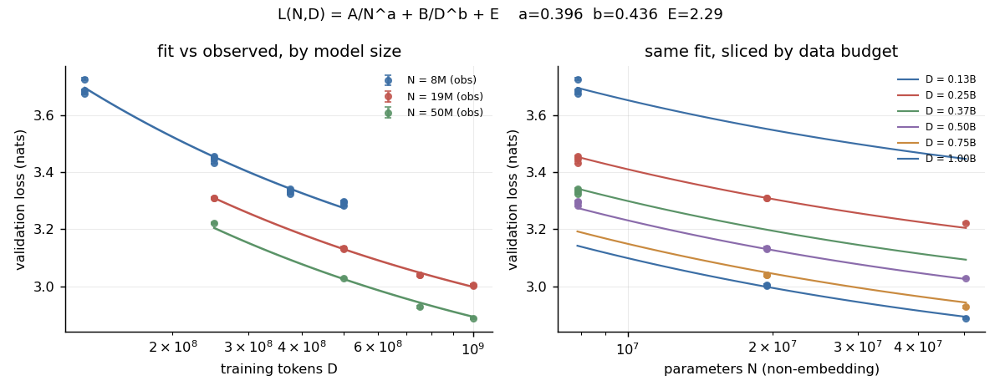
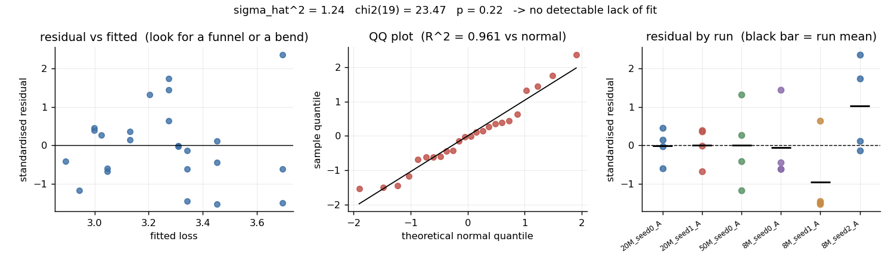
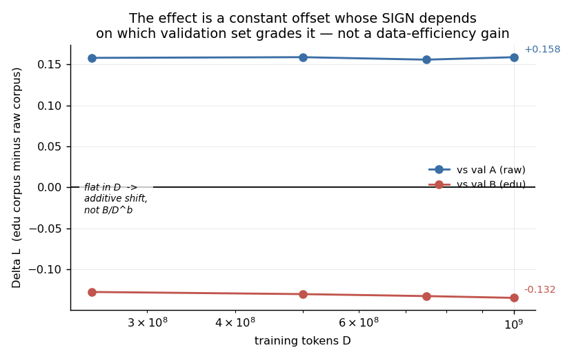
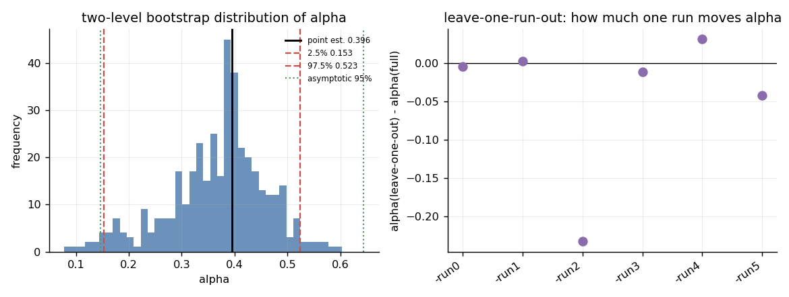
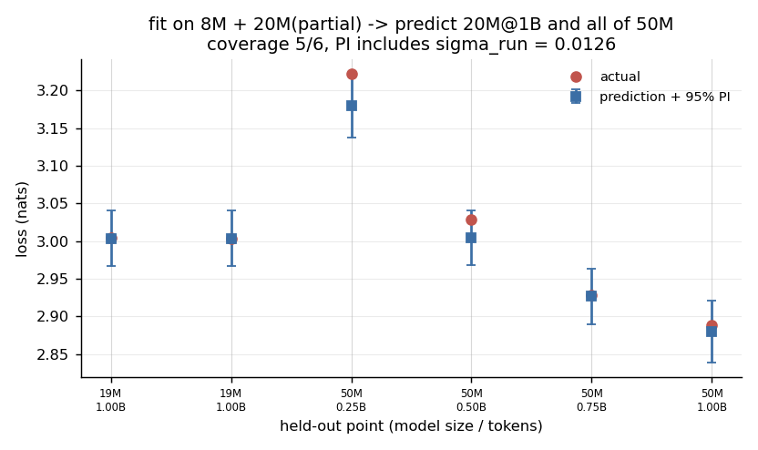
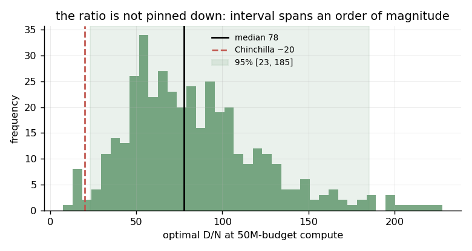

# scaling-law-lab

在单张 RTX 4090 上，用 **约 12 元人民币**完成一次 Chinchilla 式的 scaling law 实证研究：
自己训 8M / 20M / 50M 的同构小模型族，拟合幂律曲线，做外推验证，再做一次数据质量消融——
并且**把"这些数字有多可信"当作主要研究对象而不是附注**。

| 项目 | 数值 |
|---|---|
| 硬件 | RTX 4090 24G 单卡（AutoDL，¥1.88/h） |
| 总开销 | **约 ¥12**（训练 8.5 GPU 小时 + 数据准备） |
| 模型 | 8M / 19.5M / 50.3M 非嵌入参数，全部 `head_dim=64` |
| 数据 | FineWeb 原始 vs FineWeb-edu 筛选，各约 11 亿 token |
| 观测 | 24 个 (N, D, loss)，来自 **6 次独立训练** |
| 关键结论 | α = 0.396、β = 0.436、E = 2.29 |

---

## 三句话结论

**1. 拟合本身没问题，但"参数有多准"取决于你问哪种问题。**
同一个 α = 0.396，四种口径给出 [0.147, 0.644]（渐近）、[0.153, 0.523]（两级 bootstrap）、
[0.163, 0.427]（留一法）——宽度差近一倍。因为 24 个观测只来自 6 次实验，
**有效样本量是 6 不是 24**。

**2. 外推是可用的。**
只用 8M + 20M 的前三个断点拟合，预测 20M@1B 和 50M 的全部四个断点：
**覆盖率 5/6，MAPE 0.41%**。预测区间必须包含 run 级噪声项 σ_run²，否则宽度会低估 21%。

**3. 数据消融的结论是"测不出来"，而不是"筛选有用"或"筛选有害"。**
ΔL 的符号随验证集分布翻转（raw 验证集上 +0.16，edu 验证集上 −0.13），
且在所有 D 上恒定（变异 1.9%）——这是**加性分布偏移**，不是数据效率差异。
批次受控对照（同 dump、同配额）复现同样的镜像。

---

## 六张图

### 图 1 · 拟合曲面



左：按模型尺寸切，横轴训练 token 数；右：按数据预算切，横轴参数量。
误差棒是文档级标准误（约 3e-3 nats），细到几乎不可见——**测量精度远好于实验可复现性**。

### 图 2 · 残差诊断



左：残差 vs 拟合值（无异方差、无弯曲）；中：QQ 图（R²=0.961）；
右：**按 run 分组**——`8M_seed1` 整体偏 −1σ，`8M_seed2` 偏 +1σ。

右上角是形式检验：σ̂² = 1.24，χ²(19) = 23.47，p = 0.22，**查不出失拟**。
右边那张横杠图是下一张图的前提：run 效应真实存在，所以观测不独立。

### 图 3 · 数据消融：符号随验证集翻转



两条线都完全平行于横轴。如果差异来自数据效率（`B/D^β` 项），ΔL 应随 D 衰减 45%
（因为 4^0.436 = 1.83），实测只变 1.9%。**恒定偏移 = 加性 = 不是效率差异。**

一个 9 个标准误的效应，方向却由评估集决定。

### 图 4 · α 的不确定性从哪来



左：整块重采 400 次的 α 分布；右：留一法——**去掉 run2 会让 α 变化 −0.23**，
去掉其它 run 只动 0.00~0.04。六个 run 里有一个高杠杆点。

### 图 5 · 外推与预测区间



只用左边 6 个点拟合，预测右边 6 个。覆盖 5/6，唯一未覆盖的是 50M@0.25B（差 0.0016）。
区间宽度中 σ_run 贡献 37%、参数不确定性 63%。

### 图 6 · 最优配比测不出来



中位数 78，95% 区间 [23, 185]，与 Chinchilla 的 ~20 **既不矛盾也不构成一致**。
点估计没有意义，区间才是结论。

---

## 这个项目**不是**什么

诚实清单，避免误导：

| 不是 | 原因 |
|---|---|
| 复现 Chinchilla | 只用了他们三种方法中的 Approach 3；规模小 3 个数量级 |
| 证明幂律是对的 | 只证明"在这个区间里查不出失拟"（χ² p=0.22，只能排除方差超过 59% 的失拟） |
| 得出数据质量的普适结论 | 只得出"单验证集测法分不清质量与分布" |
| 数值上可外推到 70B | 属函数形式外推，不是数值预测 |
| 独立的 24 个观测 | 只有 6 次独立训练，其余是同一 run 的中间检查点 |

---

## 局限

1. **N 只跨 6.4 倍**：A 与 α 的相关系数 = 1.00（完全共线），A 的置信区间 [−641, 1152] 跨两个数量级。
2. **cluster 数太少**：run 级重采样只有 6 个 cluster，bootstrap 分布粗糙。
3. **σ_run 同方差假设失效**：8M 0.0154 vs 20M 0.0011，差 14 倍；50M 只有 1 个 seed，无法估计。
4. **消融是语料级而非文档级**：两组文档重叠仅 0.011%，dump 只共享 2/16。
5. **四种 CI 口径相差近一倍**（α：0.264 ~ 0.497），没有单独一个可作结论。
6. **wild bootstrap 有轻微双重计数**：重采 run 已含 run 级偏移，再叠加全残差会略高估（实测宽 7%）。

---

## 快速开始

```bash
pip install -r requirements.txt

make check              # 参数表 / 形状 / 标签泄漏护栏
make report-synthetic   # 用合成数据自检整条拟合流水线（不需要 GPU）
make report             # 真实日志 → results/report.md
make plots              # 重画六张图
python -m scripts.selfcheck   # 21 项数值自检
```

`logs/` 里是 9 个真实 run 的 CSV，所以报告和图表可以随时重算。

---

## 文档地图

| 文件 | 内容 |
|---|---|
| **[研究记录.md](研究记录.md)** | **完整记录**：从预算怎么定到每一次走错的路，含全部数字 |
| [results/report.md](results/report.md) | 自动生成的统计报告（七节），`make report` 可重算 |

---

## 代码结构

```
scaling/
  model.py    185 行  GPT：RMSNorm + RoPE + 4x GeLU + tied embedding，无 bias
  data.py     117 行  按约 1M token 块洗牌；数据流状态可序列化以支持精确续训
  eval.py      82 行  文档级 SE（逐窗口位置映射）
  fit.py      452 行  WNLS / σ_run / 两级 bootstrap / 预测区间 / 联合消融 / 最优配比
  config.py   136 行  三个尺寸的定义与精确参数计数
train.py      232 行  训练循环；每步 token 数硬断言；检查点含数据流位置
data_prep/
  build_bins.py        382 行  文本 → uint16 .bin（并行编码 + dump 配额）
  train_tokenizer.py   209 行  8192 BPE
scripts/
  fit_report.py        446 行  CSV → 七节报告
  selfcheck.py         255 行  21 项数值自检
  plots.py             268 行  六张图
  check_model.py       138 行  模型族形状闸门
  check_overlap.py     103 行  两组语料的文档重叠率
run_all.sh             111 行  GPU 队列（可续跑）
```

---

## 与 Chinchilla 的关系

函数形式 $$L(N,D) = E + A/N^{\alpha} + B/D^{\beta}$$ 与最优配比闭式解
$$N_{opt} = G(C/6)^{a}$$ 直接来自 [Hoffmann et al. 2022](https://arxiv.org/abs/2203.15556)，
本仓库验证了数值搜索与闭式解一致（差 0.00%）。

**不同之处**：他们在 log 空间用 Huber 损失 + L-BFGS，我们在原始空间用加权最小二乘
（因为每个点的测量精度已知）。交叉验证显示两种方法给出的 β 差 1.4%、E 差 1.3%、
α 差 9%（在 α 自己的区间宽度之内）。

**他们没做的是不确定性量化**——这正是本仓库补的部分。
